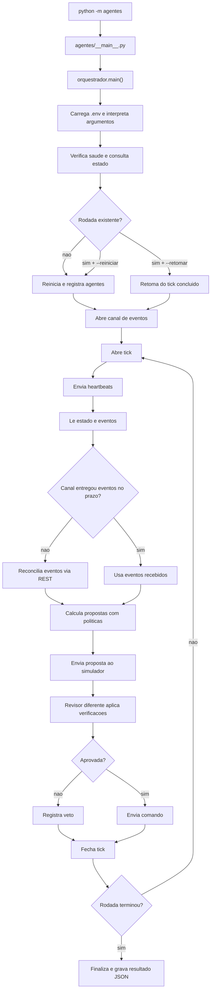

# ocean-agentes

Back-end multiagente da frota Operacao Oceanica. O projeto nao importa codigo do simulador: comunica-se com ele pela API, documentada em `<OCEAN_BASE_URL>/docs`.

Este README descreve o codigo disponivel na branch `main`: o modo por ticks. A implementacao experimental por turnos e LLM esta separada na branch [`novoModelo`](https://github.com/RodrigoGalvao9/Ocean-deloitte-agent/tree/novoModelo).

## Requisitos

- Python instalado.
- O simulador Ocean em execucao e acessivel pela URL configurada.
- Dependencias instaladas a partir de `requirements.txt`.

## Instalacao

No PowerShell:

```powershell
python -m venv .venv
.\.venv\Scripts\python.exe -m pip install -r requirements.txt
Copy-Item .env.example .env
.\.venv\Scripts\python.exe -m agentes
```

Edite `.env` para ajustar `OCEAN_BASE_URL` ou outras opcoes. O programa tambem aceita variaveis de ambiente e argumentos de linha de comando.

## Configuracao e opcoes

| Opcao | Efeito |
|---|---|
| `--url URL` | Sobrescreve `OCEAN_BASE_URL`; padrao `http://127.0.0.1:8000`. |
| `--modo conformance` ou `official` | Escolhe o cenario; padrao `conformance`. |
| `--canal sse`, `ws`, `webhook` ou `rest` | Escolhe como receber eventos; padrao `sse`. |
| `--reiniciar` | Descarta a rodada atual no servidor e inicia outra. |
| `--retomar` | Continua uma rodada interrompida. |
| `--saida CAMINHO` | Define onde salvar o resultado; padrao `results`. |
| `--webhook-url URL` | URL publica chamada pelo servidor quando se usa webhook. |
| `--webhook-porta PORTA` | Porta local do receptor webhook; padrao `9000`. |

`--reiniciar` e `--retomar` sao mutuamente exclusivos. Sem uma dessas opcoes, o programa evita substituir uma rodada existente.

Exemplos:

```powershell
.\.venv\Scripts\python.exe -m agentes
.\.venv\Scripts\python.exe -m agentes --canal rest
.\.venv\Scripts\python.exe -m agentes --modo official --canal ws
.\.venv\Scripts\python.exe -m agentes --retomar
```

### Webhook com simulador remoto

O servidor precisa conseguir acessar sua maquina. Abra um tunel (por exemplo, ngrok ou Cloudflare Tunnel) para a porta local e passe a URL publica em `--webhook-url` ou `OCEAN_WEBHOOK_URL`. Cada entrega e validada com HMAC-SHA256.

## Fluxo da execucao

O ponto de entrada `python -m agentes` chama `main()` do orquestrador. A partir dali, o programa verifica o simulador, prepara ou retoma a rodada e repete o processamento dos ticks ate a finalizacao:



### O que acontece em cada tick

1. Abre a janela do tick no simulador e envia um heartbeat para cada agente.
2. Consulta o estado completo dos navios e aguarda os eventos pelo canal escolhido.
3. Se o canal atrasar mais de dois segundos, busca os eventos por REST para nao decidir com dados incompletos.
4. As politicas calculam no maximo uma proposta por navio, priorizando seguranca, economia e navegacao.
5. A proposta e revisada por outro agente. Se aprovada, o orquestrador envia o comando; caso contrario, registra o veto.
6. Fecha o tick e repete o ciclo. Ao final, finaliza a rodada e salva o resultado.

O estado dos navios vem de `/api/v1/state`, pois os eventos de telemetria nao incluem todos os campos usados pelas politicas.

## Agentes e politicas

- `navigation` (`navegador`): define velocidade com base em prazo, combustivel e limites.
- `safety` (`guardiao`): trata tempestades e avarias, e participa da revisao cruzada.
- `economy` (`economista`): calcula a necessidade de abastecimento antes da partida.

As regras e estimativas de consumo estao em `agentes/politicas.py`. O cliente e os canais se comunicam com o simulador exclusivamente pela API.

## Rotas utilizadas

| Finalidade | Rotas |
|---|---|
| Saude, estado e resultado | `GET /health`, `GET /api/v1/state`, `GET /api/v1/events`, `GET /api/v1/result` |
| Eventos em tempo real | `GET /api/v1/stream`, `WS /ws/telemetry`, `POST` e `DELETE /api/v1/webhooks` |
| Controle da rodada | `POST /api/v1/round/reset`, `/api/v1/round/open-tick`, `/api/v1/round/close-tick`, `/api/v1/round/finalize` |
| Agentes | `POST /api/v1/heartbeats`, `/api/v1/decisions`, `/api/v1/commands` |

## Arquivos principais

| Arquivo | Responsabilidade |
|---|---|
| `agentes/__main__.py` | Encaminha `python -m agentes` para o orquestrador. |
| `agentes/orquestrador.py` | Argumentos de execucao, inicializacao da rodada e loop dos ticks. |
| `agentes/cliente.py` | Cliente HTTP, retries, autenticacao, heartbeats, decisoes e comandos. |
| `agentes/canais.py` | Recepcao de eventos por SSE, WebSocket, webhook ou REST. |
| `agentes/politicas.py` | Regras deterministicas para navegacao, economia e seguranca. |

## Depuracao no VS Code

O arquivo `.vscode/launch.json` disponibiliza perfis para o modo por ticks, canal REST, retomada e reinicio.

1. Abra esta pasta no VS Code e selecione o interpretador `.venv\Scripts\python.exe`.
2. Abra **Run and Debug**, escolha um perfil `Ocean: ...` e pressione `F5`.
3. Coloque breakpoints no orquestrador, cliente, canais ou politicas; a execucao usa o terminal integrado e carrega o `.env` local.

O perfil de reinicio esta explicitamente nomeado **RESETAR rodada atual**: ele descarta o estado atual do simulador. Use-o apenas quando realmente quiser comecar uma nova rodada.

## Markmap interativo

Os diagramas Mermaid sao renderizados diretamente pelo GitHub. Como a pagina do README nao permite scripts interativos, o workflow publica o mapa mental completo como pagina separada e uma previa SVG que aparece abaixo:

[Abrir o Markmap interativo](https://rodrigogalvao9.github.io/Ocean-deloitte-agent/)

[](https://rodrigogalvao9.github.io/Ocean-deloitte-agent/)

Para habilitar a publicacao, em **Settings > Pages**, selecione **GitHub Actions** como fonte. O workflow publica novamente quando o README mudar na branch `main`.

## Implementacao experimental de LLM

O modo por turnos, os agentes LLM via Groq/OpenRouter, o mock local e seus perfis de depuracao continuam separados na branch [`novoModelo`](https://github.com/RodrigoGalvao9/Ocean-deloitte-agent/tree/novoModelo). Essas opcoes nao estao disponiveis no codigo da `main`; para usa-las, troque para essa branch. A separacao evita documentar como executaveis na `main` comandos que dependem de arquivos ainda nao integrados nela.

O resultado desta branch e salvo em `results/final_result_<modo>.json`.
