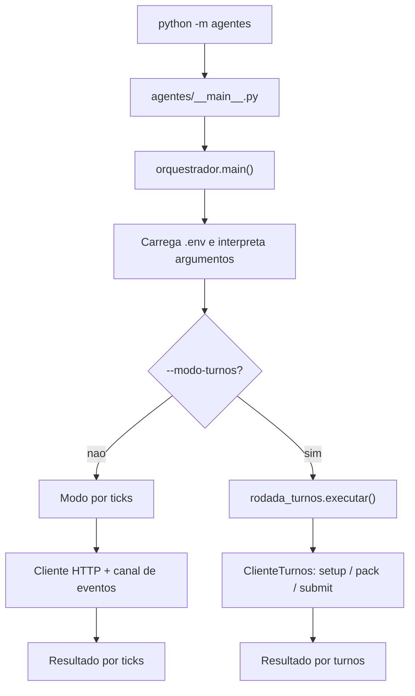
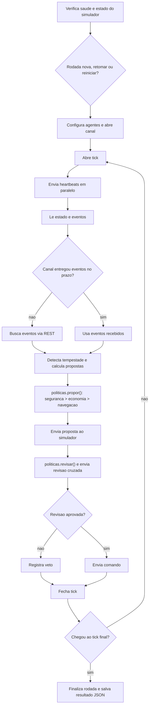
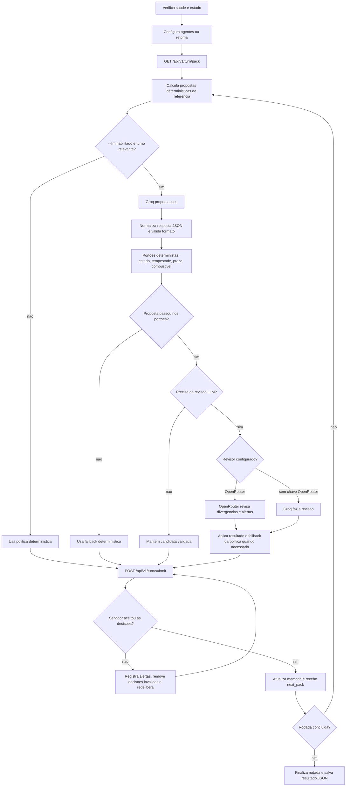

# ocean-agentes

Back-end multiagente para a frota da Operacao Oceanica. O projeto nao importa codigo do simulador: comunica-se com ele pela API, documentada em `<OCEAN_BASE_URL>/docs`.

Ha dois modos de execucao:

- **Modo por ticks**, o fluxo original: o cliente abre e fecha cada tick, envia heartbeats e recebe eventos por SSE, WebSocket, webhook ou REST.
- **Modo por turnos**, adicionado na branch `novoModelo`: usa os endpoints `/api/v1/turn/*`; o servidor recebe um pacote de estado e avanca a rodada quando as decisoes sao submetidas. Pode usar a politica deterministica ou agentes LLM via Groq.

## Requisitos

- Python compativel com as dependencias listadas em `requirements.txt`.
- O simulador Ocean em execucao e acessivel pela URL configurada.
- Para usar LLM com o servico real, uma chave de API Groq.

## Instalacao

No PowerShell:

```powershell
python -m venv .venv
.\.venv\Scripts\python.exe -m pip install -r requirements.txt
Copy-Item .env.example .env
```

Edite `.env` conforme o ambiente e inicie com `.\.venv\Scripts\python.exe -m agentes`. O arquivo `.env` e opcional: os argumentos de linha de comando e variaveis de ambiente tambem podem fornecer a configuracao.

## Configuracao

Variaveis principais do simulador:

| Variavel | Padrao | Finalidade |
|---|---|---|
| `OCEAN_BASE_URL` | `http://127.0.0.1:8000` | URL base da API do simulador. |
| `OCEAN_DEFAULT_SCENARIO_MODE` | `conformance` | Cenario usado quando `--modo` nao e informado. |
| `OCEAN_CANAL` | `sse` | Canal padrao do modo por ticks. |
| `OCEAN_ADMIN_TOKEN` | vazio | Token administrativo, se exigido pelo servidor. |
| `OCEAN_WEBHOOK_URL` | vazio | URL publica do webhook quando o servidor remoto precisa chamar esta maquina. |
| `OCEAN_WEBHOOK_PORTA` | `9000` | Porta local do receptor webhook. |
| `OCEAN_AVANCO` | `6` | Avanco padrao em ticks por submissao no modo por turnos. |
| `OCEAN_LLM_ORCAMENTO` | `120000` | Limite de tokens do LLM para uma execucao; pode ser sobrescrito por `--llm-orcamento`. |

Configuracao adicional do Groq para `--llm`:

| Variavel | Padrao | Finalidade |
|---|---|---|
| `GROQ_API_KEY` | sem padrao | Chave obrigatoria para o servico Groq real. |
| `GROQ_MODEL` | `openai/gpt-oss-120b` | Modelo solicitado. |
| `GROQ_BASE_URL` | `https://api.groq.com/openai/v1` | URL base compativel com a API OpenAI. |
| `GROQ_RPM` | `25` | Limite local de requisicoes por minuto. |
| `GROQ_TPM` | `6800` | Limite local de tokens por minuto. |
| `GROQ_TPD` | `170000` | Limite local de tokens por dia. |
| `GROQ_USO_ARQUIVO` | `results/.groq_uso.json` | Arquivo persistente com o consumo diario estimado/retornado pela API. |

Revisor no OpenRouter (usado em `--llm-modo completo` quando a chave existe; sem ela o Groq tambem revisa):

| Variavel | Padrao | Finalidade |
|---|---|---|
| `OPENROUTER_API_KEY` | sem padrao | Chave do OpenRouter. |
| `OPENROUTER_MODEL` | `nvidia/nemotron-3.5-lightning:free` | Modelo revisor. |
| `OPENROUTER_BASE_URL` | `https://openrouter.ai/api/v1` | URL base da API (nao e o nome do modelo). |
| `OPENROUTER_RPM` | `18` | Limite local de requisicoes por minuto. |
| `OPENROUTER_USO_ARQUIVO` | `results/.openrouter_uso.json` | Consumo diario do revisor. |

Cada cliente tem limites, contador e desligamento proprios: se o Groq cair, o revisor continua como guarda reserva, e vice-versa. `--llm-orcamento` vale para o propositor. O endpoint gratuito do Nemotron registra o uso para melhorar produtos da NVIDIA: nao envie dados sigilosos.

Os limites locais do cliente Groq sao configurados com margem abaixo dos limites de plano descritos no codigo. Guarde `GROQ_API_KEY` apenas em variavel de ambiente ou em um `.env` local; nao a publique nem a inclua em commits.

## Modos de execucao

### Modo por ticks (original)

```powershell
.\.venv\Scripts\python.exe -m agentes
.\.venv\Scripts\python.exe -m agentes --canal rest
.\.venv\Scripts\python.exe -m agentes --canal sse --modo official
```

| Opcao | Efeito |
|---|---|
| `--canal sse`, `ws`, `webhook` ou `rest` | Escolhe como receber eventos; padrao `sse`. |
| `--modo conformance` ou `official` | Define o cenario. |
| `--reiniciar` | Descarta e reinicia a rodada atual do servidor. |
| `--retomar` | Continua uma rodada interrompida, sem reinicializa-la. |
| `--url URL` | Sobrescreve `OCEAN_BASE_URL`. |
| `--saida CAMINHO` | Define a pasta dos resultados; padrao `results`. |
| `--webhook-url URL` | Define a URL publica chamada pelo servidor no modo webhook. |
| `--webhook-porta PORTA` | Define a porta local do webhook; padrao `9000`. |

Para usar webhook com simulador remoto, o servidor precisa alcancar sua maquina. Abra um tunel (por exemplo, ngrok ou Cloudflare Tunnel) para a porta local e passe a URL publica em `--webhook-url` ou `OCEAN_WEBHOOK_URL`. Cada entrega e validada com HMAC-SHA256.

### Modo por turnos (deterministico)

```powershell
.\.venv\Scripts\python.exe -m agentes --modo-turnos --reiniciar
.\.venv\Scripts\python.exe -m agentes --modo-turnos --modo official --avanco 12 --reiniciar
.\.venv\Scripts\python.exe -m agentes --modo-turnos --retomar
```

`--modo-turnos` troca o ciclo de ticks pelo protocolo de turnos. O cliente nao usa o canal selecionado nem envia heartbeats individuais ou abre/fecha janelas manualmente: configura os agentes, busca um pacote, monta decisoes, submete-as e recebe o proximo pacote.

| Opcao | Efeito |
|---|---|
| `--modo-turnos` | Usa `/api/v1/turn/*`. |
| `--avanco N` | Solicita avancar de 1 a 432 ticks por submissao; padrao `6` (ou `OCEAN_AVANCO`). |
| `--retomar` / `--reiniciar` | Retoma a rodada ou descarta-a e inicia outra. Sao mutuamente exclusivos. |

O cliente usa `stop_on_events` ao submeter. O proprio servidor interrompe o avanco em eventos e transicoes dos navios. Se o servidor rejeitar decisoes especificas, o programa descarta as apontadas nos erros de validacao e tenta submeter as restantes. Se a resposta do submit se perder, consulta o pacote para verificar se o servidor ja avancou, em vez de reenviar a operacao as cegas.

### Modo por turnos com LLM (Groq)

Configure `GROQ_API_KEY` e execute:

```powershell
.\.venv\Scripts\python.exe -m agentes --modo-turnos --llm --reiniciar
.\.venv\Scripts\python.exe -m agentes --modo-turnos --llm --llm-modo proposta --avanco 6 --retomar
```

`--llm` exige `--modo-turnos`. O LLM e um decisor assistivo sobre a politica existente, nao uma substituicao dos controles:

- `--llm-modo completo` (padrao): o modelo propoe acoes e tambem revisa as propostas elegiveis.
- `--llm-modo proposta`: o modelo propoe, mas nao faz a chamada LLM de revisao; as regras deterministicas continuam validando as acoes.
- `--llm-orcamento N`: define o teto de tokens desta execucao; padrao `120000`. Ao atingir o teto, o programa desliga o LLM e continua com a politica deterministica.

O propositor LLM so e consultado quando ha evento novo ou uma proposta nao critica. O revisor LLM so avalia propostas diferentes das da politica e, como guarda reserva, acoes que o servidor nao permite agora ou de navios cuja acao anterior ele recusou; uma resposta critica permitida pelo servidor nao fica sujeita a esse veto. Em 429 persistente (ou `retry-after` acima de 60 s) ou apos 3 falhas seguidas, o LLM e desligado ate o fim da execucao. Cada consulta e cada espera por limite aparecem no log.

As respostas do modelo sao convertidas para o formato de acao esperado e passam por validacao deterministica de estado, limite, tempestade, prazo, combustivel e frequencia de alteracao de velocidade. Respostas invalidas ou propostas vetadas nao passam diretamente como comandos. Eventos criticos de tempestade (E01) e avaria de motor (E04) continuam sendo tratados deterministicamente. Se uma chamada Groq falhar ou o orcamento acabar, o turno segue pela politica deterministica.

O contador diario de uso e gravado em `results/.groq_uso.json` por padrao, permitindo que o limite diario seja respeitado entre execucoes. `--llm-modo proposta` pode reduzir o consumo por evitar a etapa de revisao feita pelo modelo.

#### Teste local do fluxo LLM sem chave Groq real

O repositorio inclui um servidor Groq simulado em `tests/mock_groq.py`. Em um terminal, inicie-o:

```powershell
.\.venv\Scripts\python.exe tests\mock_groq.py --porta 9100 --modo ecoa
```

Em outro terminal PowerShell, configure a URL e uma chave ficticia para esse mock e execute uma rodada. O simulador Ocean ainda precisa estar acessivel; estas configuracoes evitam chamadas ao servico Groq externo:

```powershell
$env:GROQ_API_KEY = "chave-local-de-teste"
$env:GROQ_BASE_URL = "http://127.0.0.1:9100/v1"
.\.venv\Scripts\python.exe -m agentes --modo-turnos --llm --reiniciar
```

O mock oferece os modos `ecoa`, `ruidoso`, `erro500`, `rate429`, `veta`, `lixo` e `vazio` para exercitar respostas normais, propostas invalidas, vetos, limites de requisicao e falhas. Nao use a chave ficticia com o endpoint real.

## Funcionamento dos agentes

No modo por ticks, cada ciclo abre a janela, envia heartbeats, espera os eventos, propoe uma acao, solicita revisao de outro agente, envia o comando aprovado e fecha a janela. Se o canal atrasar mais que dois segundos, os eventos sao reconciliados via REST. O estado completo dos navios vem de `/api/v1/state`.

No modo por turnos, o simulador fornece o pacote com navios, economia e eventos; o cliente gera as decisoes e as envia em lote. As regras deterministicas em `agentes/politicas.py` sao compartilhadas pelos dois modos.

### Fluxo de entrada

Este diagrama mostra como a execucao parte de `python -m agentes` e e encaminhada para o modo escolhido:



### Fluxo detalhado: modo por ticks



### Fluxo detalhado: modo por turnos e LLM



Se uma chamada LLM falhar, exceder o orcamento ou retornar uma resposta invalida, a politica deterministica continua sendo a referencia. As respostas criticas de seguranca para tempestades e avarias nao sao substituidas pelo LLM.

Especialistas implementados:

- `navigation` (`navegador`): planeja velocidade considerando prazo, combustivel, avarias e limites.
- `safety` (`guardiao`): trata tempestades e avarias, e participa da revisao cruzada.
- `economy` (`economista`): avalia abastecimento antes da partida e disponibilidade de caixa.
- `coordinator`: cadastrado pelo protocolo por turnos para completar a configuracao de papeis do servidor.

Compras de combustivel sao sequenciadas para evitar competir pelo mesmo caixa. No modo LLM, decisoes validas continuam sujeitas aos portoes deterministas e ao resultado do servidor.

## Depuracao no VS Code

O arquivo `.vscode/launch.json` contem perfis para iniciar o modo por ticks, iniciar ou retomar uma rodada por turnos, rodar com LLM e iniciar o servidor Groq simulado.

1. Abra a pasta do repositorio no VS Code e selecione o interpretador Python `.venv\Scripts\python.exe`.
2. Selecione **Run and Debug** e escolha o perfil `Ocean: ...`.
3. Pressione `F5`; os breakpoints funcionam no terminal integrado.
4. Para depurar com o mock, inicie primeiro `Ocean: Groq mock local`, aguarde o servidor subir e depois inicie `Ocean: LLM via mock local`.

Os perfis leem o `.env` local. O perfil que reseta a rodada esta nomeado explicitamente como **RESETAR rodada atual**; ele descarta o estado atual do simulador. Prefira os perfis sem reset ou de retomada quando quiser preservar uma rodada existente. O perfil do mock sobrescreve as chaves do provedor para usar somente `127.0.0.1`; o simulador Ocean ainda precisa estar acessivel.

## Mapa mental interativo (Markmap)

O GitHub renderiza os diagramas Mermaid acima diretamente no README, mas bloqueia scripts e iframes que permitiriam embutir um Markmap interativo na propria pagina. O workflow publica uma versao navegavel gerada a partir deste README:

[Abrir o Markmap interativo do README](https://rodrigogalvao9.github.io/Ocean-deloitte-agent/)

[](https://rodrigogalvao9.github.io/Ocean-deloitte-agent/)

Depois da primeira publicacao, a imagem acima mostra uma previa estatica dentro do README; clique nela para abrir a versao interativa. A linha da previa e removida da fonte durante a geracao para evitar que o SVG inclua a si proprio.

Para habilitar a publicacao, em **Settings > Pages**, selecione **GitHub Actions** como fonte. Depois do merge na branch `main`, o workflow gera e publica o Markmap sempre que o README mudar. A pagina interativa e separada; o fluxo Mermaid continua visivel diretamente aqui no README.

## Arquivos principais

| Arquivo | Responsabilidade |
|---|---|
| `agentes/orquestrador.py` | CLI, inicializacao e selecao entre modo por ticks e modo por turnos. |
| `agentes/cliente.py` | Cliente HTTP comum, retries, identidades, heartbeats, decisoes e comandos do modo por ticks. |
| `agentes/canais.py` | Recepcao de eventos via SSE, WebSocket, webhook ou REST. |
| `agentes/politicas.py` | Regras deterministicas de seguranca, navegacao, economia e revisao. |
| `agentes/turnos.py` | Cliente REST para configurar agentes, obter pacotes, submeter decisoes e finalizar turnos. |
| `agentes/decisao.py` | Adaptacao do pacote de turno para as politicas compartilhadas e montagem das decisoes. |
| `agentes/rodada_turnos.py` | Loop completo do modo por turnos, recuperacao de erros e gravacao dos resultados. |
| `agentes/groq.py` | Cliente Groq, limitadores de uso, contabilizacao de tokens e leitura de respostas JSON. |
| `agentes/llm_agentes.py` | Propostas/revisoes LLM, validacao, portoes de seguranca e fallback deterministico. |
| `tests/mock_groq.py` | API Groq simulada para testes locais do modo LLM. |

## Rotas utilizadas

| Finalidade | Rotas |
|---|---|
| Saude, estado e resultado | `GET /health`, `GET /api/v1/state`, `GET /api/v1/events`, `GET /api/v1/result` |
| Eventos em tempo real | `GET /api/v1/stream`, `WS /ws/telemetry`, `POST` e `DELETE /api/v1/webhooks` |
| Rodada por ticks | `POST /api/v1/round/reset`, `/api/v1/round/open-tick`, `/api/v1/round/close-tick`, `/api/v1/round/finalize` |
| Agentes por ticks | `POST /api/v1/heartbeats`, `/api/v1/decisions`, `/api/v1/commands` |
| Rodada por turnos | `POST /api/v1/turn/setup-agents`, `GET /api/v1/turn/pack`, `POST /api/v1/turn/submit` |

## Resultados

- Modo por ticks: `results/final_result_<modo>.json`.
- Modo por turnos: `results/final_result_<modo>_turnos.json`.
- Uso diario do Groq: `results/.groq_uso.json` por padrao.

O modo por turnos finaliza a rodada pelo endpoint de finalizacao e registra tambem o progresso de governanca e a prova multiagente retornados pelo simulador.
